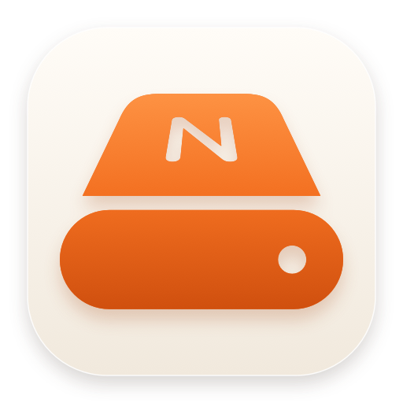
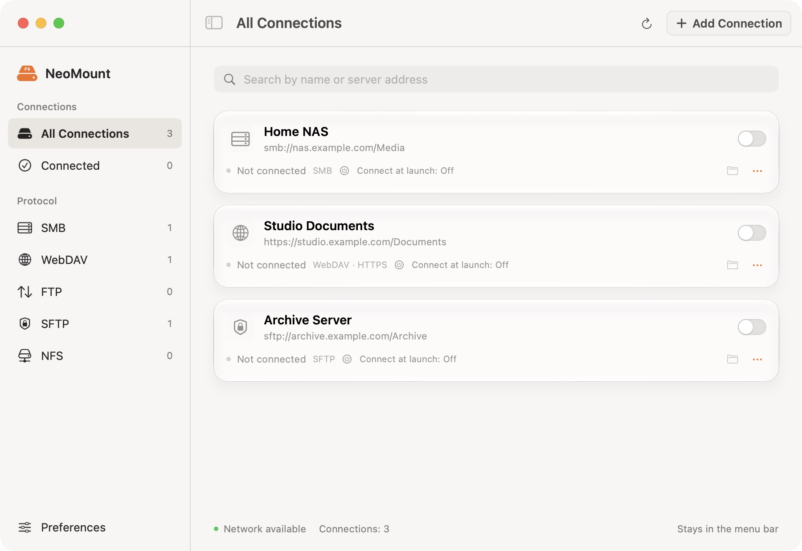
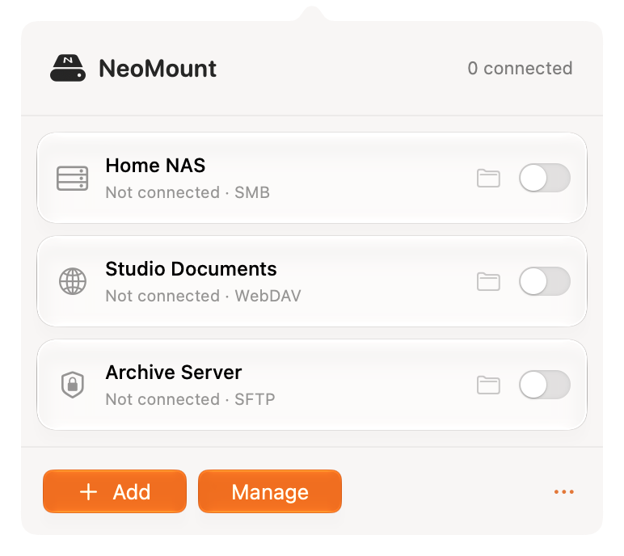
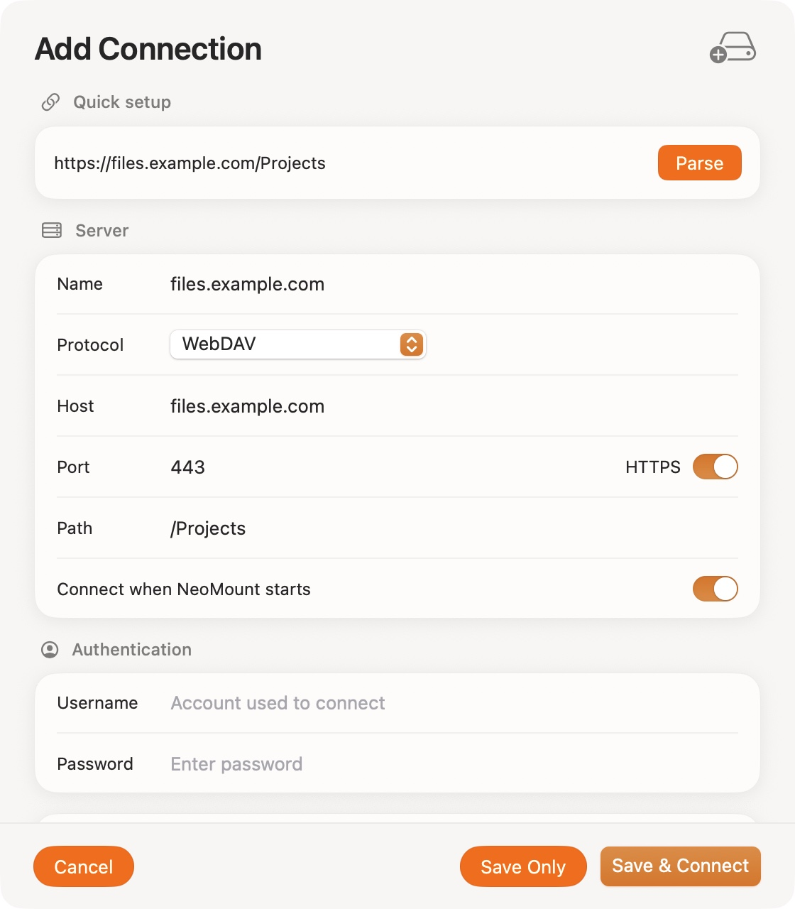
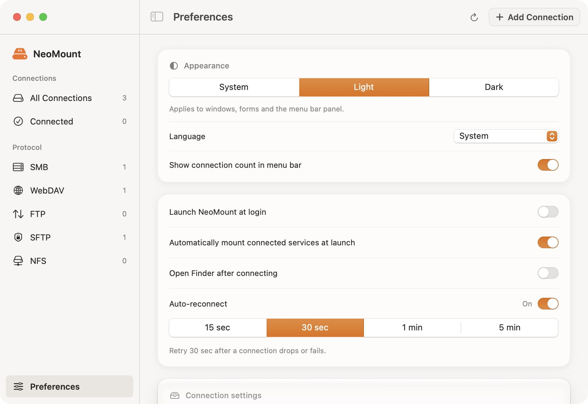
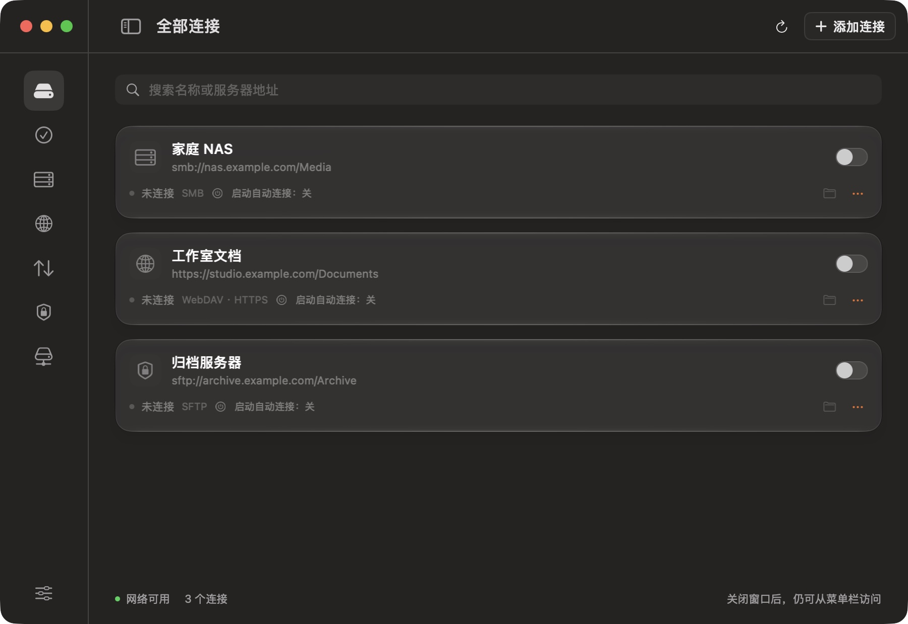

<h1 align="center">NeoMount</h1>

Your network drives, one click away.

  <a href="https://github.com/RoperYoung/NeoMount-for-Mac/releases/download/v1.10.11/NeoMount-1.10.11-arm64.dmg"><strong>Download NeoMount 1.10.11</strong></a> ·
  <a href="https://github.com/RoperYoung/NeoMount-for-Mac/releases">Release notes</a> ·
  <a href="README.md">简体中文</a>

macOS 13+ · Apple Silicon · Free to use · English & Chinese

Keep your NAS, shared folders and remote servers in one place. Connect with a switch, then work with your files in Finder. Close the main window and NeoMount stays in the menu bar.

### Full connection manager

Filter by protocol in the sidebar or search by name and server address. The button beside the page title collapses the sidebar to a column of icons.

### Menu bar

The badge on the menu bar icon shows how many drives are connected; you can hide it in Preferences. Click the icon to see each server’s status, connect or disconnect with a switch, or open a connected drive in Finder. Add a server or open the full manager from the bottom row. The More menu gives quick access to auto-reconnect, retry intervals and appearance.

Closing the main window keeps NeoMount available here.

### Connect and manage

- **Five protocols:** SMB, WebDAV, FTP, SFTP and NFS.
- Open **Quick setup → Help** for URLs and eight-field templates for all five protocols. Insert an example or copy an AI prompt, then paste and parse your server details. You can enter your password locally.
- **Reconnect when needed:** choose a retry interval of 15 seconds, 30 seconds, 1 minute or 5 minutes. Manually disconnected drives stay paused after relaunch, wake, and network recovery.
- **Spot unavailable mounts:** checks whether the mounted directory can be read and offers Reconnect when needed. The old volume is unmounted normally first; busy disks stay mounted.
- **Start your way:** launch at login and use the global startup mounting switch alongside each drive’s individual setting.
- **Take your settings with you:** import and export connections without including passwords.
- **Stay up to date:** background checks surface new releases in the menu bar panel and Preferences. Allow macOS notifications to open release notes directly from a notification.

### Add a connection

### Preferences

Dark appearance with a collapsed sidebar (Chinese interface)

 

Captured from NeoMount 1.10.10 on a Mac using example connections.

### Install

1. [Download the DMG](https://github.com/RoperYoung/NeoMount-for-Mac/releases/download/v1.10.11/NeoMount-1.10.11-arm64.dmg), open it, and drag **NeoMount** into **Applications**.
2. Open NeoMount from Applications and add a server.
3. Optionally enable launch at login in Preferences and automatic connection for individual servers.

If an earlier version reports an error connecting to the installer, quit NeoMount, use the DMG above to replace NeoMount in Applications, and reopen it. Your saved connections are retained.

**To update from 1.10.7 to 1.10.11**, click the NeoMount icon in the Mac menu bar, choose **… → Check for Updates…**, and follow the prompts to install and relaunch. If you started the update from Preferences and the install button appears to do nothing, close NeoMount’s Preferences and click the install button again.

**Upgrading from 1.10.2 or earlier:** version 1.10.3 introduces a unified app identifier and requires a one-time DMG installation. Turn off launch at login in the old version, quit it, and replace NeoMount in Applications. Your connections, saved passwords and common preferences are retained. Re-enable launch at login in the new version if needed. Future releases support in-app updates.

This release requires **macOS 13 or later on Apple Silicon**. An Intel build is not available. Choose System, Simplified Chinese or English in **Preferences → Appearance → Language**, then reopen the app to apply the change.

### Free to use · Privacy and security

NeoMount is free to use, with no subscription, ads or app account. This repository hosts downloads, updates and support material; the application source code is not published. GitHub’s automatic **Source code** archives contain only this repository’s documentation and assets. Choose the **DMG** to install the app.

- Both the app and DMG are **Developer ID signed**, individually **notarized by Apple**, and have stapled notarization tickets. Releases include SHA-256 checksums.
- There is no analytics or advertising tracking. Connection settings stay on your Mac; saved passwords are encrypted locally with AES-GCM. Credentials are used to authenticate to the servers you choose.
- Update checks contact GitHub. Downloads use HTTPS and Sparkle verifies their Ed25519 signatures. Automatic checks can be disabled in Preferences.
- Certificate verification remains enabled. The first SFTP connection requires host fingerprint confirmation; a changed fingerprint stops the connection.

See [Security & Privacy](SECURITY.md) for details. Notarization is not a guarantee against every security issue or an endorsement by Apple.

### Before you connect

FTP does not encrypt traffic; use SFTP or HTTPS WebDAV for sensitive connections. SFTP currently supports password authentication, not SSH private key selection. A successful connection test does not prove that a disk can be mounted or that you have write access.

NeoMount manages network mounts, not offline synchronization. FTP and SFTP use a bundled rclone bridge for everyday file access and copying. Check compatibility before using software that requires random writes. Disks in use are never forcibly unmounted.

For help, [open an issue](https://github.com/RoperYoung/NeoMount-for-Mac/issues) with your macOS version, NeoMount version, protocol and error message. Please leave out passwords, full private server addresses and configuration files.

---

Built with [Sparkle](https://sparkle-project.org/) and [rclone](https://rclone.org/). See [third-party licenses](licenses) and [NeoMount usage terms](LICENSE.txt).
