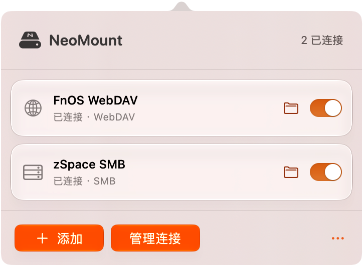
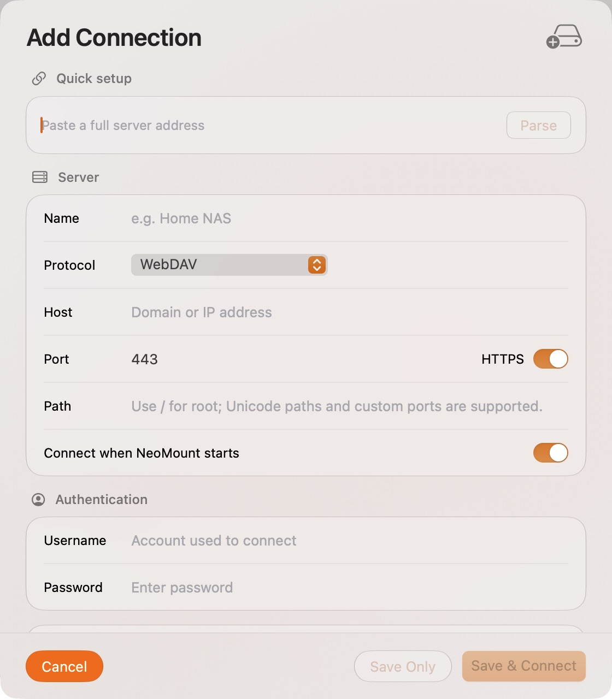
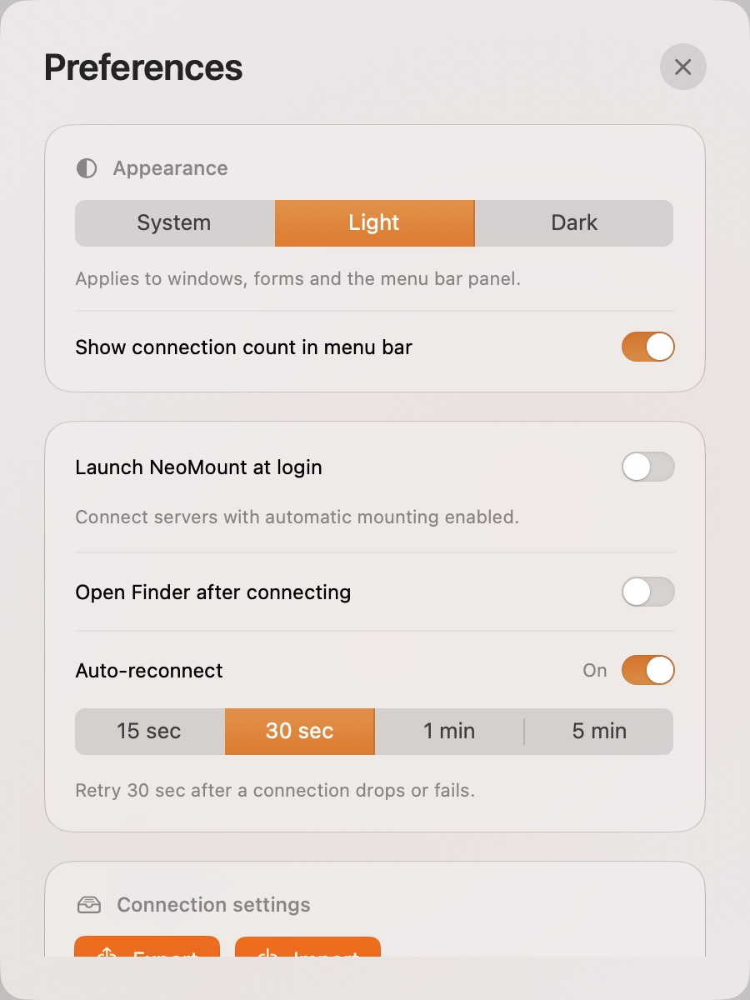

<h1 align="center">NeoMount</h1>

Your network drives, one click away.

  <a href="https://github.com/RoperYoung/NeoMount-for-Mac/releases/download/v1.10.3/NeoMount-1.10.3-arm64.dmg"><strong>Download NeoMount 1.10.3</strong></a> ·
  <a href="https://github.com/RoperYoung/NeoMount-for-Mac/releases">Release notes</a> ·
  <a href="README.md">简体中文</a>

macOS 13+ · Apple Silicon · Free to use · English & Chinese

Keep your NAS, shared folders and remote servers in one place. Connect with a switch, then work with your files in Finder. Close the main window and NeoMount stays in the menu bar.

### Menu bar

The badge on the menu bar icon shows how many drives are connected; you can hide it in Preferences. Click the icon to see each server’s status, connect or disconnect with a switch, or open a connected drive in Finder. Add a server or open the full manager from the bottom row. The More menu gives quick access to auto-reconnect, retry intervals and appearance.

Closing the main window keeps NeoMount available here.

### Full connection manager

### Connect and manage

- **Five protocols:** SMB, WebDAV, FTP, SFTP and NFS.
- **Paste an address:** fill in the protocol, host, port and path from a full URL. Unicode paths and custom ports are supported.
- **Reconnect when needed:** choose a retry interval of 15 seconds, 30 seconds, 1 minute or 5 minutes. Manually disconnecting pauses retries for that connection.
- **Start your way:** launch at login and choose which servers should connect when the app starts.
- **Take your settings with you:** import and export connections without including passwords.
- **Stay up to date:** check for new releases in the app. Updates come from this repository and are verified before installation.

<table>
  <tr>
    <td align="center"> Add a connection</td>
    <td align="center"> Preferences and updates</td>
  </tr>
</table>

Real app screenshots captured on a Mac, without desktop backgrounds. The menu bar panel shows two connected drives; the other views use example configurations.

### Install

1. [Download the DMG](https://github.com/RoperYoung/NeoMount-for-Mac/releases/download/v1.10.3/NeoMount-1.10.3-arm64.dmg), open it, and drag **NeoMount** into **Applications**.
2. Open NeoMount from Applications and add a server.
3. Optionally enable launch at login in Preferences and automatic connection for individual servers.

**Upgrading from 1.10.2 or earlier:** version 1.10.3 introduces a unified app identifier and requires a one-time DMG installation. Turn off launch at login in the old version, quit it, and replace NeoMount in Applications. Your connections, saved passwords and common preferences are retained. Re-enable launch at login in the new version if needed. Future releases support in-app updates.

This release requires **macOS 13 or later on Apple Silicon**. An Intel build is not available. The interface follows the app’s macOS language preference. To choose English or Simplified Chinese, go to **System Settings → General → Language & Region → Applications**.

### Free to use · Privacy and security

NeoMount is free to use, with no subscription, ads or app account. This repository hosts downloads, updates and support material; the application source code is not published. GitHub’s automatic **Source code** archives contain only this repository’s documentation and assets. Choose the **DMG** to install the app.

- Both the app and DMG are **Developer ID signed**, individually **notarized by Apple**, and have stapled notarization tickets. Releases include SHA-256 checksums.
- There is no analytics or advertising tracking. Connection settings stay on your Mac; saved passwords are encrypted locally with AES-GCM. Credentials are used to authenticate to the servers you choose.
- Update checks contact GitHub. Downloads use HTTPS and Sparkle verifies their Ed25519 signatures. Automatic checks can be disabled in Preferences.
- Certificate verification remains enabled. The first SFTP connection requires host fingerprint confirmation; a changed fingerprint stops the connection.

See [Security & Privacy](SECURITY.md) for details. Notarization is not a guarantee against every security issue or an endorsement by Apple.

### Before you connect

FTP does not encrypt traffic; use SFTP or HTTPS WebDAV for sensitive connections. SFTP currently supports password authentication, not SSH private key selection. A successful connection test does not prove that a disk can be mounted or that you have write access.

NeoMount manages network mounts, not offline synchronization. FTP and SFTP use a bundled rclone bridge for everyday file access and copying. Check compatibility before using software that requires random writes. Disks in use are never forcibly unmounted.

For help, [open an issue](https://github.com/RoperYoung/NeoMount-for-Mac/issues) with your macOS version, NeoMount version, protocol and error message. Please leave out passwords, full private server addresses and configuration files.

---

Built with [Sparkle](https://sparkle-project.org/) and [rclone](https://rclone.org/). See [third-party licenses](licenses) and [NeoMount usage terms](LICENSE.txt).
