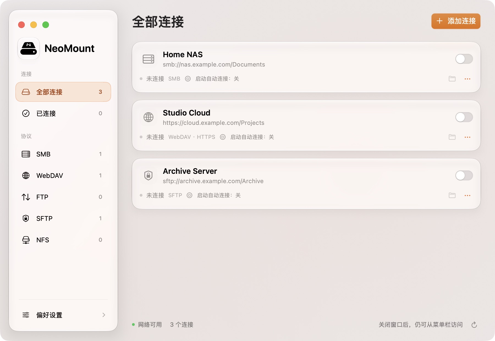
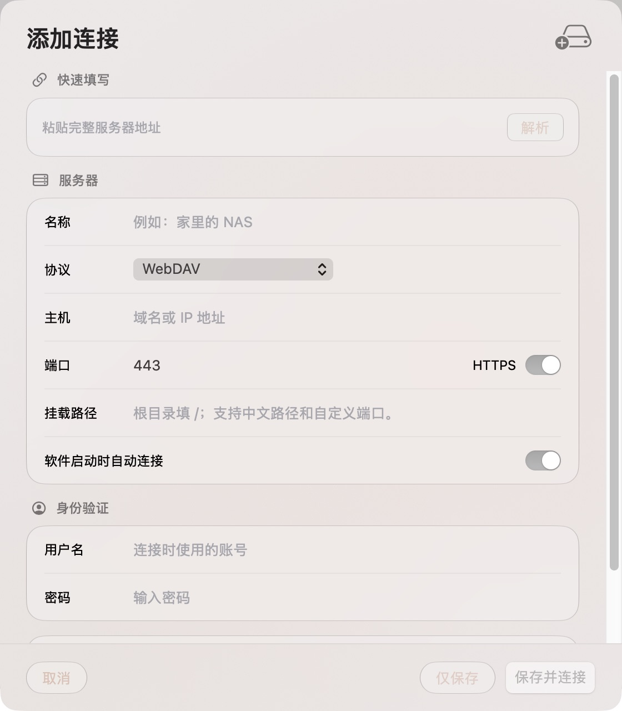
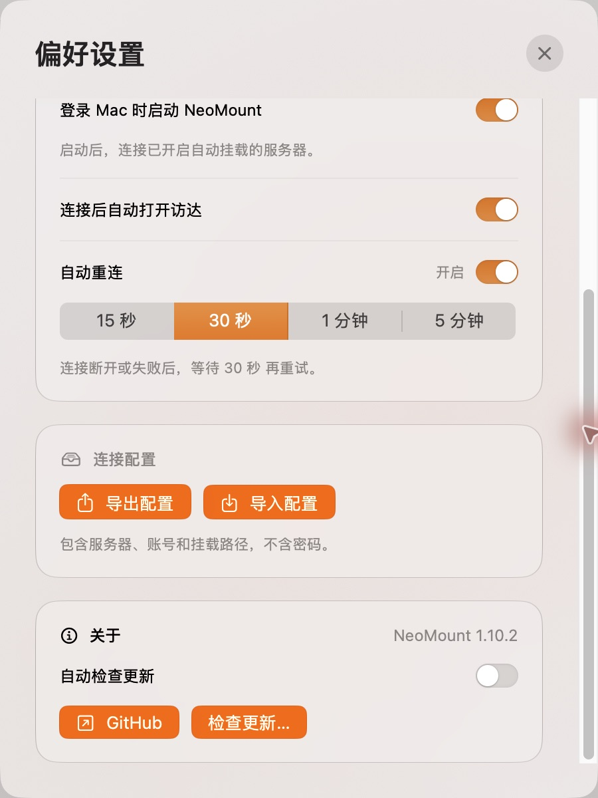
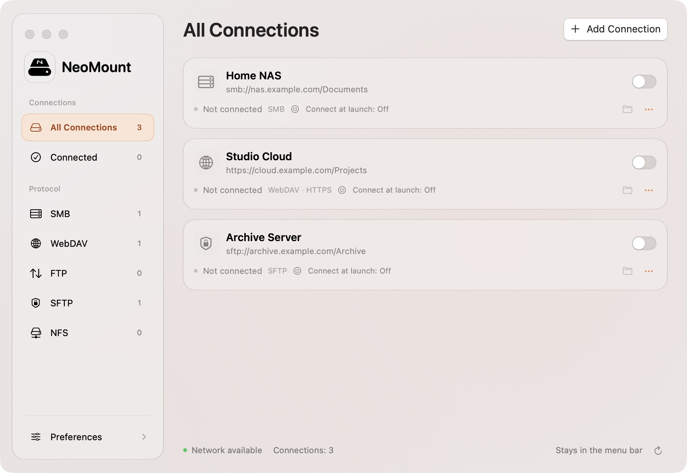

  

<h1 align="center">NeoMount</h1>

把网络磁盘放进菜单栏。

  <a href="https://github.com/RoperYoung/NeoMount-for-Mac/releases/download/v1.10.2/NeoMount-1.10.2-arm64.dmg"><strong>下载 NeoMount 1.10.2</strong></a> ·
  <a href="https://github.com/RoperYoung/NeoMount-for-Mac/releases">版本记录</a> ·
  <a href="README.en.md">English</a>

macOS 13+ · Apple Silicon · 免费使用 · 中英文界面

NAS、家里的共享文件夹、远程服务器，集中放在一个地方。打开开关就连接，在访达里照常使用；关掉主窗口，NeoMount 仍留在菜单栏。

### 连接与管理

- **五种协议**：SMB、WebDAV、FTP、SFTP、NFS。
- **少填几遍地址**：粘贴完整链接，自动拆分协议、主机、端口和路径。支持中文路径与自定义端口。
- **断线后再试**：重连间隔可选 15 秒、30 秒、1 分钟或 5 分钟。主动断开后不会反复连回来。
- **按你的习惯启动**：可随 Mac 登录启动，也可以为每个服务器单独设置启动时连接。
- **换台 Mac 也好迁移**：导入、导出连接配置，密码不包含在导出文件里。
- **跟得上新版本**：内置更新检查，从本仓库下载更新，校验签名后再安装。

<table>
  <tr>
    <td align="center"> 添加连接</td>
    <td align="center"> 偏好设置与更新</td>
  </tr>
</table>

英文界面

 

截图来自 Mac 上实际运行的应用，仅保留应用窗口。连接名称和地址为示例，未连接真实服务器。

### 安装

1. [下载 DMG](https://github.com/RoperYoung/NeoMount-for-Mac/releases/download/v1.10.2/NeoMount-1.10.2-arm64.dmg)，打开后将 **NeoMount** 拖到 **Applications（应用程序）**。
2. 在应用程序文件夹中打开 NeoMount，添加你的服务器。
3. 如果想开机就能用，在偏好设置中开启登录时启动，并给需要的连接打开启动自动连接。

当前安装包适用于 **Apple Silicon（M 系列芯片）**，暂不提供 Intel 版本。界面跟随 macOS 的应用语言，可在「系统设置 → 通用 → 语言与地区 → 应用程序」中指定简体中文或 English。

### 免费使用 · 隐私与安全

NeoMount 免费使用，无订阅、广告或应用账号。这个仓库用于软件下载、更新和问题反馈，不提供应用源代码。GitHub 自动生成的 **Source code** 压缩包只有本仓库的介绍和资源；安装软件请选择 **DMG**。

- 应用与 DMG 均使用 **Developer ID 签名**，分别通过 **Apple 公证**，并附带公证票据。发布页提供 SHA-256 校验值。
- 没有使用统计或广告追踪。连接配置留在本机，保存的密码使用 AES-GCM 加密；连接时，认证信息只用于你指定的服务器。
- 检查更新会访问 GitHub；更新下载使用 HTTPS，并由 Sparkle 校验 Ed25519 签名。可在偏好设置中关闭自动检查。
- 保持系统证书验证。SFTP 首次连接需要确认服务器指纹，指纹改变会停止连接。

更多细节见 [安全与隐私](SECURITY.md)。Apple 公证不是“绝对安全”的保证，也不代表软件由 Apple 开发。

### 使用说明

FTP 本身不加密，敏感连接建议使用 SFTP 或 HTTPS WebDAV。当前 SFTP 使用密码认证，暂不支持选择 SSH 私钥。连接测试用于检查连通性，不等于挂载成功或拥有写入权限。

NeoMount 管理网络挂载，不提供离线同步。FTP / SFTP 通过内置 rclone 桥接，适合日常文件访问与复制；需要随机写入的专业软件，请先确认兼容性。正在使用的磁盘不会被强制卸载。

遇到问题可以[提交 Issue](https://github.com/RoperYoung/NeoMount-for-Mac/issues)，附上 macOS 版本、NeoMount 版本、协议和报错即可，请不要上传密码、真实完整连接地址或配置文件。

---

感谢 [Sparkle](https://sparkle-project.org/) 与 [rclone](https://rclone.org/)。第三方许可见 [licenses](licenses)。NeoMount 的使用说明见 [LICENSE.txt](LICENSE.txt)。
